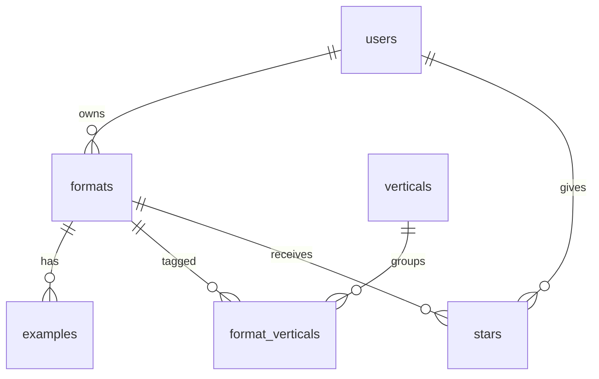

# PLAN.md — Viral Radar

## 1. Pitch

I'm building **Viral Radar**, a personal tracker for short-video *formats* that are going viral and that a brand could remake, because my job is to tell sales teams and clients "what should we make next" and today that answer lives in a spreadsheet only I can read.

A single viral video cannot be copied. A format that many creators reuse can. I log each format once, the app scores it, and I can find it again by category in seconds.

**How often I'll use it:** every weekday morning to log new finds and pick the three I send to sales, and in every client call when someone asks for ideas in their category.

## 2. Features

Numbered in build order. One feature, one issue, one branch, one pull request. 1 to 7 are the spine, 8 to 10 are my three.

1. **Sign up and login.** As a new visitor, I want to create my own account inside the app, then log in and log out, so that my radar is private to me. Every account is a row in `users`, and every query is filtered by the logged-in user.
2. **Data model.** As the builder, I want `users`, `formats`, `examples` and `verticals` connected by real relationships, so that every later feature has a place to put its data.
3. **Create, read, update, delete.** As a strategist, I want to add a format, see my list, open one format's detail page, edit it, and delete it after an "are you sure?" confirmation, so that my radar stays current.
4. **Validation.** As a user, I want a friendly message when I leave the name or the example link blank or paste something that is not a link, so that I never save a broken entry.
5. **Stars.** As a strategist, I want to star formats and open a "Starred" view, so that this week's picks are one click away. All stars live in one `stars` table.
6. **Find things.** As a strategist, I want to search by name, filter by vertical, creative type and trend status, and sort by newest or highest score, so that I can answer "what works for gaming" during a call.
7. **Dashboard.** As a strategist, I want a chart of formats per vertical and three numbers (total formats, average score, hottest vertical this month), so that I can see where my radar is thin.
8. **Composite score (mine).** As a strategist, I want each format scored 0 to 100 from the numbers I enter, so that ranking is consistent instead of a gut call.
9. **Replication brief (mine).** As a strategist, I want one button that copies the generation prompt and the swap rules (what to change, what never to copy), so that a creative team can start the remake immediately.
10. **CSV import (mine).** As a strategist, I want to upload a CSV exported from my old spreadsheet and have each row become a format, so that I do not retype 160 entries. Rows that fail validation are listed with the reason and skipped.

Score formula for feature 8, every term scaled 0 to 1:

```
freshness = 0.6 × min(1, new_in_7_days / 8) + (0.4 if Rising or Peak, 0.15 if Steady, 0 if Fading)
breadth   = min(1, number of verticals / 3)
score     = 100 × (0.30 × heat/100 + 0.20 × freshness + 0.25 × ai_replicable/5 + 0.15 × breadth + 0.10 × ad_value/5)
```

**Real data:** the first five formats are entered by hand as soon as feature 3 works. Feature 10 then brings in the rest of my existing radar, about 160 formats I have already analysed. No placeholder text anywhere.

## 3. Database

Postgres. Six tables.



| Table | Column | Type | Notes |
|---|---|---|---|
| **users** | id | text (uuid) | Primary key, same id as the auth account |
| | email | text | |
| | display_name | text | |
| | created_at | date | |
| **formats** | id | number | Primary key |
| | user_id | text (uuid) | Foreign key to users.id. The owner. |
| | name | text | Required |
| | creative_type | text | UGC with Avatar, CGI, Product Only, Animation, Branding |
| | trend_status | text | Rising, Peak, Steady, Fading |
| | region | text | NA, APAC, LATAM, EUI, METAP, Global |
| | heat | number | 0 to 100 |
| | ai_replicable | number | 1 to 5 |
| | ad_value | number | 1 to 5 |
| | new_in_7_days | number | |
| | score | number | Computed on save |
| | mechanic, hook, why_works, brand_usage | text | |
| | prompt, swaps | text | The replication brief |
| | first_seen | date | |
| | created_at | date | |
| **examples** | id | number | Primary key |
| | format_id | number | Foreign key to formats.id |
| | platform | text | TikTok, Instagram, Xiaohongshu |
| | url | text | Required. Link only, no video files stored. |
| | views | number | |
| | posted_on | date | |
| **verticals** | id | number | Primary key |
| | name | text | Retail, CPG, App, Gaming, Leads & Services, Dining |
| **format_verticals** | format_id | number | Foreign key to formats.id |
| | vertical_id | number | Foreign key to verticals.id |
| | | | Primary key is (format_id, vertical_id) |
| **stars** | user_id | text (uuid) | Foreign key to users.id |
| | format_id | number | Foreign key to formats.id |
| | starred_at | date | |
| | | | Primary key is (user_id, format_id). One table for everyone. |

How they connect:

- users to formats: one-to-many. A format belongs to exactly one user.
- formats to examples: one-to-many.
- formats to verticals: **many-to-many** through `format_verticals`.
- users to formats through `stars`: **many-to-many** junction, "this user starred this format".

Row-level security on every table: a row is readable and writable only when its `user_id` (or its parent format's `user_id`) is the logged-in user.

## 4. Tests

1. **Data isolation.** **Given** user A has five formats and user B has none, **when** B logs in and opens the list, the dashboard, and the direct link to one of A's formats, **then** B sees an empty list, zero in every stat, and "not found", and A's five formats are untouched.
2. **Dashboard.** **Given** a user whose three formats have scores 90, 60 and 30, **when** they open the dashboard, **then** "Total formats" shows 3 and "Average score" shows 60.0, and after they delete the format scored 30 it shows 2 and 75.0.

Each test ships in the pull request of the feature it protects (test 1 with login, test 2 with the dashboard), with a plain-English explanation, a red-then-green screenshot pair, and one sentence on what real change would break it.

## 5. Technologies

| Choice | What | Why |
|---|---|---|
| Coding agent | Claude Code | It already runs my collection scripts, so it knows the data, and it works through issues, branches and pull requests. |
| Framework | Next.js (App Router) with TypeScript | One project holds the pages and the server code, and it deploys with no configuration. |
| Styling | Tailwind CSS | A consistent dark theme without a stylesheet per page. |
| Database | Supabase Postgres | Real relational tables with foreign keys, plus row-level security so "each user sees only their own data" is enforced by the database and not only by my code. |
| Sign up and login | Supabase Auth, email and password | It ships with the database, so the account id and `users.id` are the same value. |
| Hosting | Vercel | Every merge to `main` redeploys the live URL, and every pull request gets a preview link. |
| Chart | Recharts | One bar chart is all the dashboard needs and this is the smallest way to get it in React. |
| Validation | Zod | The same rules run in the form and on the server, so the friendly message and the real check never disagree. |
| CSV parsing | Papa Parse | It handles quoted commas and line breaks inside cells, which my analysis text is full of. |
| Tests | Vitest and Playwright | Vitest for the dashboard maths and the score formula, Playwright for data isolation in a real browser with two accounts. |

Imported data is public post links and my own analysis text only. No video files, no client names, no API keys, no internal documents.

## 6. Design

Dark, dense, quiet. Near-black background, off-white text, one accent colour (electric lime) used only for the score and the primary button. Trend status is a small coloured dot: green Rising, amber Peak, grey Steady, red Fading. Formats are tall cards in a grid so the list feels like a video app, not a table. Numbers use a monospace face. The star is a single tap on the card, no menu.

Borrowing from:

- **Pinterest**: the grid of tall cards and the one-tap save.
- **Product Hunt**: a ranked list with the score on the left.
- **Linear**: dark theme, tight spacing, fast filters.

## 7. Risks and cuts

**Least sure I can build:** row-level security done right. It is easy to make the list private and still leave a direct link, the dashboard counts, or the stars table readable by another user. Test 1 exists to catch exactly that, and I will write it in the same pull request as login.

**Second risk:** CSV import. One row has to land in three related tables (format, its verticals, its examples) without creating duplicates when I upload the same file twice.

**Cut order if I run out of time:**

1. CSV import shrinks to formats only, no examples or verticals from the file.
2. Region as a filter. Vertical, type and status matter more.
3. The copy-brief button becomes plain selectable text.
4. If CSV import is cut entirely, I replace it with a "random pick" button so I still ship three of my own.

Never cut: the seven spine features and the two tests.
