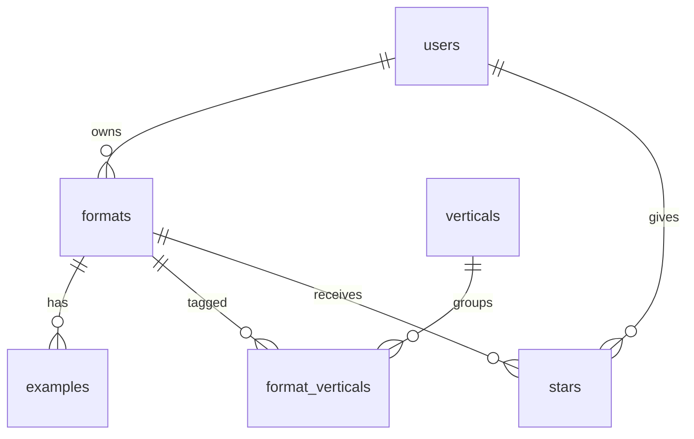

# Database schema

Postgres on Supabase. The SQL that creates everything is in `supabase/migrations`, applied in file order.

## Tables

### users
One row per account. Created automatically by a trigger when someone signs up.

| Column | Type | Notes |
|---|---|---|
| id | uuid | Primary key. Same value as the Supabase Auth account id. |
| email | text | Required |
| display_name | text | |
| created_at | timestamp | Defaults to now |

### formats
The main item: one viral format a user is tracking.

| Column | Type | Notes |
|---|---|---|
| id | number | Primary key, auto-generated |
| user_id | uuid | Foreign key to users.id. The owner. Defaults to the logged-in user. |
| name | text | Required, cannot be blank |
| creative_type | text | UGC with Avatar, UGC w/o Avatar, CGI, Product Only, Animation, Branding |
| trend_status | text | Rising, Peak, Steady, Fading |
| region | text | NA, APAC, LATAM, EUI, METAP, Global |
| heat | number | 0 to 100 |
| ai_replicable | number | 1 to 5 |
| ad_value | number | 1 to 5 |
| new_in_7_days | number | 0 or more |
| score | number | Composite score, computed when the format is saved |
| mechanic, hook, why_works, brand_usage | text | The analysis |
| prompt, swaps | text | The replication brief |
| first_seen | date | |
| created_at | timestamp | Defaults to now |

### examples
Example videos for a format. Links only, no video files.

| Column | Type | Notes |
|---|---|---|
| id | number | Primary key, auto-generated |
| format_id | number | Foreign key to formats.id |
| platform | text | TikTok, Instagram, Xiaohongshu, YouTube, Other |
| url | text | Required, must start with http:// or https:// |
| views | number | 0 or more |
| posted_on | date | |

### verticals
A fixed list of six industries: Retail, CPG, App, Gaming, Leads & Services, Dining.

| Column | Type | Notes |
|---|---|---|
| id | number | Primary key |
| name | text | Unique |

### format_verticals
Junction table connecting formats to verticals.

| Column | Type | Notes |
|---|---|---|
| format_id | number | Foreign key to formats.id |
| vertical_id | number | Foreign key to verticals.id |

Primary key is the pair (format_id, vertical_id), so a format cannot be tagged with the same vertical twice.

### stars
Junction table connecting users to formats. One table for everyone: each row says "this user starred this format".

| Column | Type | Notes |
|---|---|---|
| user_id | uuid | Foreign key to users.id. Defaults to the logged-in user. |
| format_id | number | Foreign key to formats.id |
| starred_at | timestamp | Defaults to now |

Primary key is the pair (user_id, format_id), so a user cannot star the same format twice.

## How the tables relate

- **users to formats: one-to-many.** A user owns many formats. A format has exactly one owner.
- **formats to examples: one-to-many.** A format has many example videos.
- **formats to verticals: many-to-many**, through `format_verticals`. A format fits several industries, and an industry has many formats.

- **users to formats through stars: many-to-many.** A user stars many formats. The table is built so a format could be starred by many users, although today each user only ever sees their own formats.

Deleting a user deletes their formats and stars. Deleting a format deletes its examples, its vertical tags and any stars on it.

## Who can see what

Row-level security is on for every table, so the database itself refuses cross-user access even if the app code has a bug.

- `users`: you can read and update only your own row.
- `formats`: you can read, add, change and delete only rows where `user_id` is you.
- `examples` and `format_verticals`: allowed only when the parent format is yours.
- `stars`: you can read and remove only your own stars, and you can add a star only as yourself on a format you own.
- `verticals`: any signed-in user can read the list. Nobody can change it through the app.
